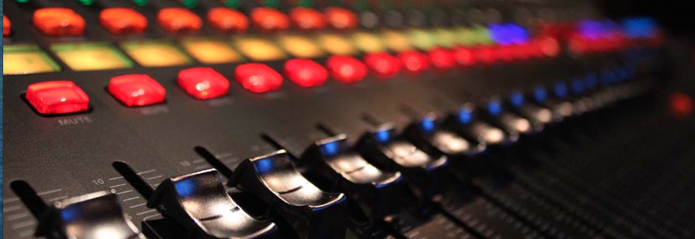

<p align="center">
  
</p>
-->

<h1 align="center">Marco Toninato</h1>
<h3 align="center">Audio Engineer · Sound Designer · AI Voice & Audiovisual Creator</h3>

<p align="center">
  Barcelona, Spain &nbsp;·&nbsp; Italian / English / Spanish<br><br>
  <a href="https://marcotoninato.com">marcotoninato.com</a> &nbsp;·&nbsp;
  <a href="https://rrudere.brokenglitch.com">rrudere</a> &nbsp;·&nbsp;
  <a href="https://brokenglitch.com">Broken Glitch Records</a> &nbsp;·&nbsp;
  <a href="mailto:info@marcotoninato.com">info@marcotoninato.com</a>
</p>

<!-- LOGOS: upload SVGs to assets/ and remove comment markers
<p align="center">
  <a href="https://rrudere.brokenglitch.com">
    <picture>
      <source media="(prefers-color-scheme: dark)" srcset="assets/rrudere-white.svg">
      
    </picture>
  </a>
  &nbsp;&nbsp;&nbsp;
  <a href="https://brokenglitch.com">
    <picture>
      <source media="(prefers-color-scheme: dark)" srcset="assets/broken-white.svg">
      
    </picture>
  </a>
</p>
-->

---

Senior audio engineer and sound designer with 20+ years of practice, bridging high-end acoustic craft — timbral nuance, voice isolation, dynamic control — and modern AI audio workflows. I work at every stage of the audio chain: from location recording and dialogue cleanup to mixing, mastering and sound design for picture, and from voice synthesis and generative media to live audiovisual performance.

BSc Audio Production, First Class Honours (SAE Institute Milan, awarded by Middlesex University London). Freelance sound recordist, sound designer and post-producer since 2016.

---

## Audio Engineering & Post-Production

```
DAWs              │ Pro Tools · Ableton Live · Logic Pro · Cubase · Reason · Max/MSP
Location          │ Sound recordist · Boom operator · Field recording · Radio mic · IEM systems
Post-production   │ Dialogue editing · Noise reduction · Audio restoration · ADR sync
                  │ Foley · Sound design · Mixing · Mastering · Soundtrack composition
Processing        │ Vocal processing · Formant analysis · De-essing · Dynamic control
                  │ Noise floor gating · Loudness normalisation
Plugins           │ Waves · Sonnox · Soundtoys · Lexicon · NI Komplete · Serum
Broadcast         │ Radio engineering · Live mixing · Podcast setup and configuration
```

---

## AI Voice & Generative Media

```
Voice synthesis   │ Local voice cloning and singing-voice synthesis
                  │ Custom ComfyUI workflows · SoulX Singer
Generative        │ Image · music · video generation with ComfyUI
                  │ LoRA training and fine-tuning
                  │ AI output quality evaluation
Workflow design   │ Custom node pipelines · Real-time MIDI/OSC parameter control
                  │ Spout + OBS integration into generative chains
LLM-assisted      │ Claude · Gemini — scripting, documentation, production support
```

---

## Live Audiovisual

```
Visuals           │ Resolume Arena · Projection mapping · Multi-output signal routing
Live audio        │ Eurorack modular system · Ableton Live master clock
                  │ MIDI/OSC integration between audio and visual layers
Neural feedback   │ Live Stable Diffusion generation driven by Resolume via Spout and OBS
                  │ Real-time denoise and coherence control
Production design │ UV fluorescent mask design · AI-assisted 3D modeling · 3D printing
```

---

## Video & Visual Production

```
Shooting          │ Own professional video equipment · Solo and small-crew production
Editing           │ Adobe Premiere · CapCut
Still image       │ Adobe Photoshop · Illustrator
Streaming         │ OBS Studio — live streaming and podcast setup
```

---

## Hardware & Making

```
DIY studio gear   │ Preamps · compressors · EQs · outboard — built from scratch or restored
Eurorack          │ Custom modular system · module design and building
Physical computing│ Arduino · sensor integration · MIDI and OSC controllers
Acoustic treatment│ Bass traps · resonators · Schroeder diffusers
3D                │ Fusion 360 · Blender · FDM 3D printing
```

---

## Repositories

**[voice-cloning-preprocessor](https://github.com/rrudere/voice-cloning-preprocessor)** *(in progress)*
Python script that takes a folder of raw vocal recordings and outputs clean, cloning-ready files: silence trimming with Voice Activity Detection, light noise reduction, high-pass filter, loudness normalisation, and a per-file quality report. Built from practical experience preparing audio for local voice synthesis workflows.

**[rrudere_HH](https://github.com/rrudere/rrudere_HH)**
Arduino sketch for a hi-hat module built for the Ginco Synthese Grains, based on the Mozzi audio synthesis library.

---

## Links

[marcotoninato.com](https://marcotoninato.com) · [LinkedIn](https://www.linkedin.com/in/marcotoninato/)

[rrudere](https://rrudere.brokenglitch.com) · [Instagram](https://www.instagram.com/rrudere/) · [SoundCloud](https://soundcloud.com/rrudere) · [YouTube](https://www.youtube.com/@rrudere)

[Broken Glitch Records](https://brokenglitch.com) · [Instagram](https://www.instagram.com/broken_glitch_records/) · [SoundCloud](https://soundcloud.com/brokenglitchrecords) · [YouTube](https://www.youtube.com/@BrokenGlitchRecords)
